# TaskFlow — Görev Yönetim Uygulaması

Node.js/Express ile yazılmış bir REST API ve bu API'yi kullanan, Android ve iOS uyumlu bir Flutter mobil uygulamasından oluşan görev yönetim sistemi.

Backend, [Render](https://render.com) üzerinde kalıcı diskli bir sunucuda **canlı** olarak çalışır; mobil uygulama internete bağlı her yerden, kablosuz olarak kullanılabilir.

**Canlı API:** [https://taskflow-app-dg2g.onrender.com/tasks](https://taskflow-app-dg2g.onrender.com/tasks)

**Geliştiren:** Rana Tanrıverdi

---

## İçindekiler

- [Ekran Görüntüleri](#ekran-görüntüleri)
- [Özellikler](#özellikler)
- [Kullanılan Teknolojiler](#kullanılan-teknolojiler)
- [Mimari](#mimari)
- [Proje Yapısı](#proje-yapısı)
- [Canlı Sunucu ve Maliyet](#canlı-sunucu-ve-maliyet)
- [Kurulum ve Çalıştırma](#kurulum-ve-çalıştırma)
- [Telefonu Backend'e Bağlama](#telefonu-backende-bağlama)
- [API Dokümantasyonu](#api-dokümantasyonu)
- [Backend Tasarım Kararları](#backend-tasarım-kararları)
- [Hata Yönetimi](#hata-yönetimi)
- [Test](#test)
- [Platform Desteği](#platform-desteği)
- [Bilinen Sınırlamalar](#bilinen-sınırlamalar)

---

## Ekran Görüntüleri

### Görev listesi ve filtreler

| Ana ekran | "Devam ediyor" filtresi | "Tamamlandı" filtresi |
|:---:|:---:|:---:|
| 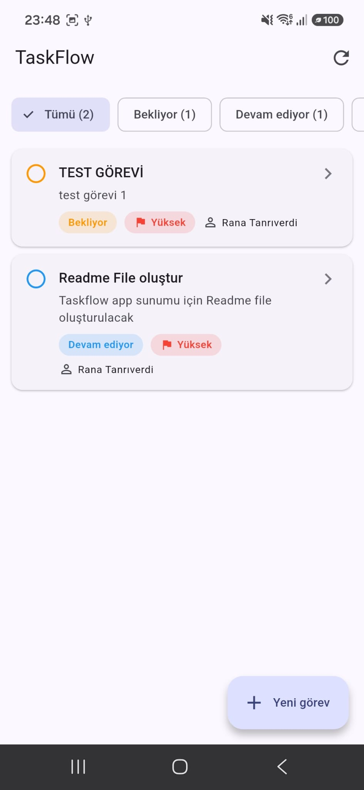 | 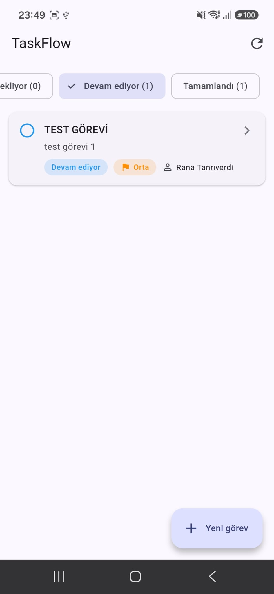 | 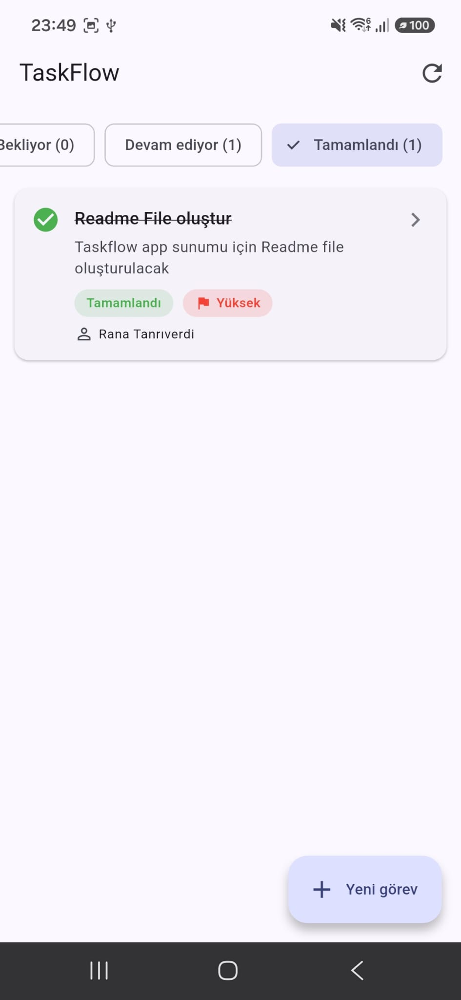 |

### Görev detayı ve düzenleme

| Durum değiştirme | Güncelleme sonrası | Düzenleme formu |
|:---:|:---:|:---:|
| 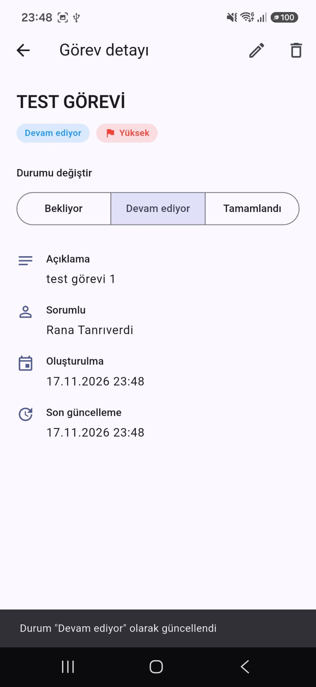 | 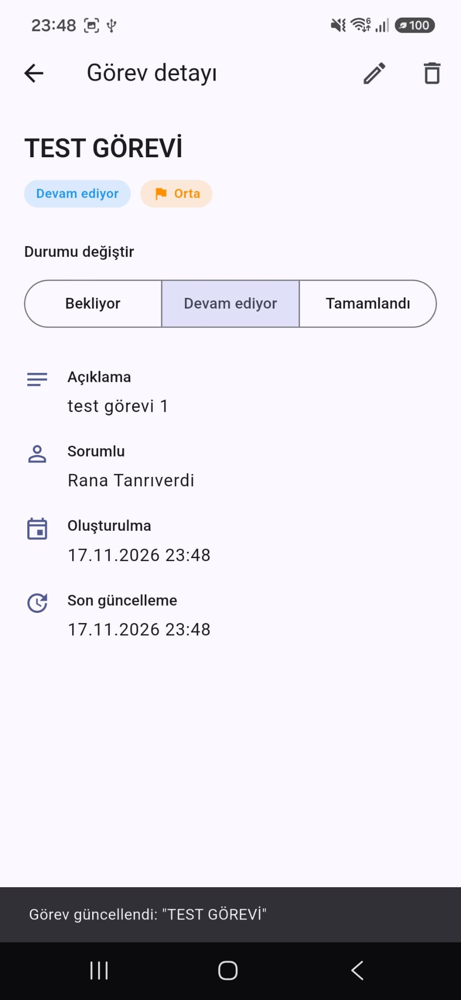 | 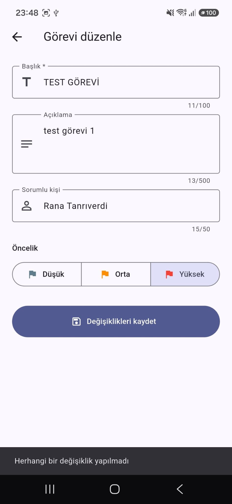 |

### Silme ve karanlık mod

| Kaydırarak silme | Silme onayı | Karanlık mod ve tema menüsü |
|:---:|:---:|:---:|
| 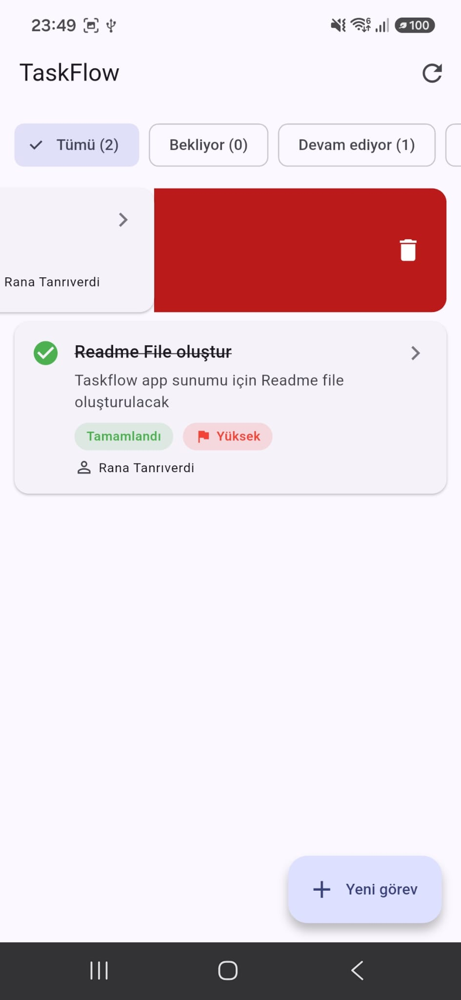 | 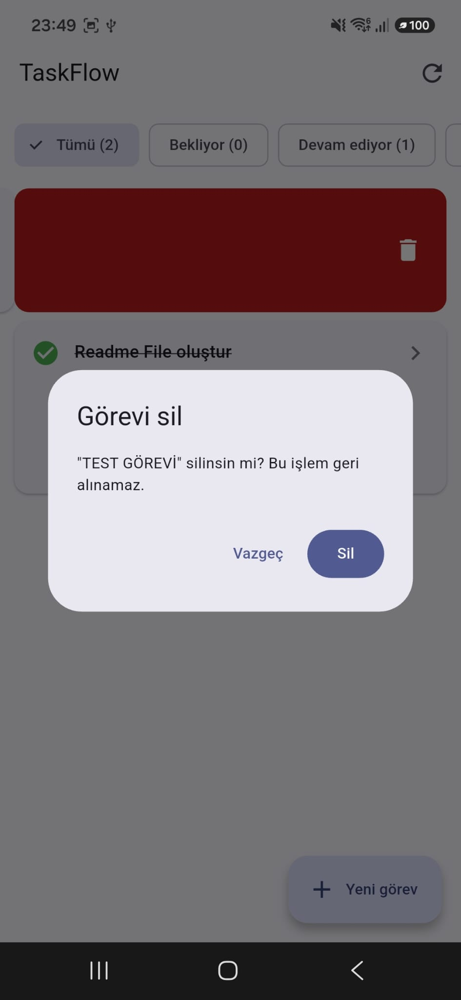 | 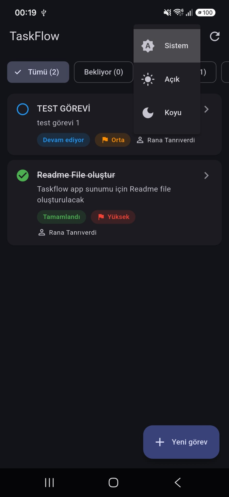 |

### Hata durumları

| Sunucuya ulaşılamadığında (boş ekran yerine) | Liste açıkken bağlantı koptuğunda |
|:---:|:---:|
| 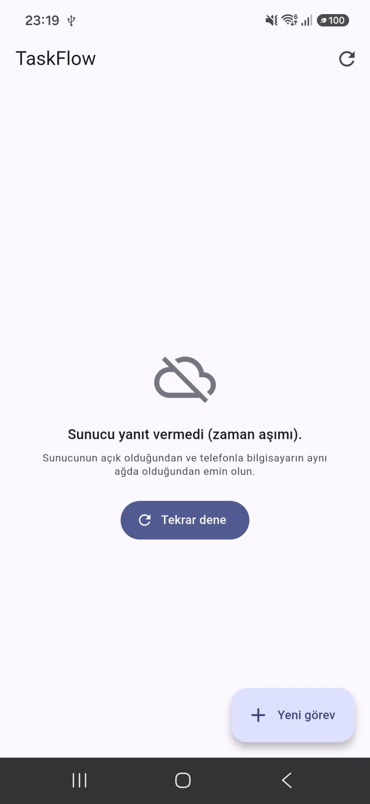 | 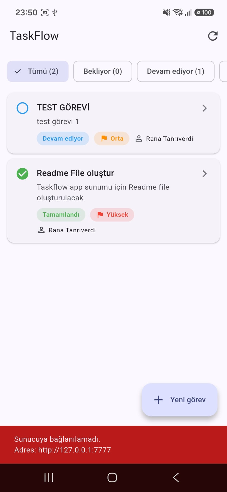 |

---

## Özellikler

### Mobil uygulama

- **Görev listesi:** Tüm görevler kart halinde; durum ve öncelik renkli etiketlerle, sorumlu kişiyle birlikte gösterilir. En yeni görev en üstte.
- **Durum filtreleri:** Tümü / Bekliyor / Devam ediyor / Tamamlandı, her birinin yanında görev sayısıyla.
- **Görev detayı:** Açıklama, sorumlu, oluşturulma ve son güncelleme tarihi. Durum tek dokunuşla değiştirilebilir.
- **Görev ekleme ve düzenleme:** Aynı form iki iş için kullanılır. Başlık zorunludur; öncelik Düşük / Orta / Yüksek olarak seçilir. Düzenlemede yalnızca değişen alanlar sunucuya gönderilir.
- **Silme:** Listede kartı sola kaydırarak veya detay ekranından, onay penceresiyle.
- **Yenileme:** Listeyi ve detay ekranını aşağı çekerek güncelleme.
- **Karanlık mod:** Telefonun temasını izler; uygulama içinden Sistem / Açık / Koyu seçilebilir.
- **Hiçbir ekran boş kalmaz:** Yükleniyor göstergesi, "Henüz görev yok" mesajı, boş filtre mesajı ve "Tekrar dene" butonlu bağlantı hatası ekranı.
- **Özel uygulama simgesi** (Android ve iOS).

### Backend

- Görevler için tam CRUD (oluşturma, listeleme, detay, güncelleme, silme).
- Gelen verinin doğrulanması (başlık zorunlu, durum ve öncelik yalnızca tanımlı değerler).
- Tüm yanıtlar, hatalar dahil, anlamlı bir JSON gövdesi döndürür.
- Her isteği tarih, metot ve adresle kaydeden logger middleware'i.
- Merkezi hata yönetimi (tanımsız adres, bozuk JSON, sunucu hatası).
- Render üzerinde canlı yayında; veriler kalıcı diskte saklanır, sunucu yeniden başlasa da kaybolmaz.

---

## Kullanılan Teknolojiler

| Katman | Teknoloji |
|---|---|
| Mobil | Flutter, Dart, Material 3, `http` paketi |
| Backend | Node.js, Express 5, `ulid` (benzersiz ID üretimi) |
| Veri saklama | JSON dosyası; canlıda Render kalıcı diskinde (`/var/data/tasks.json`) |
| Sunucu | Render Web Service (Starter, Frankfurt), 1 GB kalıcı disk, HTTPS |
| Araçlar | VS Code, Git/GitHub, Postman, Android Debug Bridge (`adb`), `flutter_launcher_icons` |

---

## Mimari

```
┌──────────────────────┐   HTTPS / JSON   ┌────────────────── Render · Frankfurt ───────────────────┐
│  Flutter uygulaması  │ ───────────────▶ │  Node.js + Express REST API  ──▶  kalıcı disk           │
│  (Android / iOS)     │ ◀─────────────── │                                   /var/data/tasks.json  │
└──────────────────────┘                  └─────────────────────────────────────────────────────────┘
```

Geliştirme sırasında aynı backend bilgisayarda da (`npm start`, port 7777) çalıştırılabilir; uygulamanın hangi sunucuya bağlanacağı `config.dart`'taki tek satırla belirlenir.

**Mobil uygulamanın katmanları:**

- **`models/`** — `Task` modeli; JSON'dan nesneye dönüşüm ve durum/öncelik değerlerinin Türkçe karşılıkları.
- **`services/`** — `ApiService`: backend ile tüm iletişim bu sınıftan geçer. Zaman aşımı, bağlantı hatası ve sunucunun döndürdüğü hata mesajları tek bir `ApiException` tipine çevrilir; ekranlar sadece bu hatayı yakalayıp kullanıcıya gösterir.
- **`screens/`** — Liste, detay ve form ekranları.
- **`widgets/`** — Ekranlarda ortak kullanılan durum ve öncelik etiketleri.
- **`config.dart`** — Backend adresi tek bir yerde tutulur; bağlantı yöntemi değişince sadece bu satır güncellenir.

---

## Proje Yapısı

```
taskflow-app/
├── backend/
│   ├── controllers/
│   │   └── tasksController.js     # İş mantığı ve doğrulama
│   ├── data/
│   │   ├── taskStore.js           # Veri dosyası okuma / yazma
│   │   └── tasks.json             # Örnek görevler (canlı sunucunun ilk verisi)
│   ├── middleware/
│   │   ├── logger.js              # İstek kaydı
│   │   └── errorHandler.js        # 404 ve genel hata yakalayıcı
│   ├── routes/
│   │   └── tasks.js               # /tasks endpoint tanımları
│   ├── server.js                  # Uygulamanın giriş noktası
│   └── package.json
├── mobile/
│   ├── assets/icon/               # Uygulama simgesi
│   ├── lib/
│   │   ├── config.dart
│   │   ├── main.dart              # Uygulama ve tema ayarları
│   │   ├── models/task.dart
│   │   ├── services/api_service.dart
│   │   ├── screens/
│   │   │   ├── task_list_screen.dart
│   │   │   ├── task_detail_screen.dart
│   │   │   └── task_form_screen.dart
│   │   └── widgets/task_badges.dart
│   ├── test/widget_test.dart      # Model birim testleri
│   ├── android/  ios/
│   └── pubspec.yaml
├── docs/screenshots/              # README görselleri
└── README.md
```

---

## Canlı Sunucu ve Maliyet

Backend, Render'ın ücretli planında yayınlandı. Ücretsiz planda sunucu 15 dakika kullanılmayınca uyuyor ve diske yazılan veriler siliniyordu; görevlerin kalıcı olması için ücretli plan ve kalıcı disk tercih edildi.

**Adres:** `https://taskflow-app-dg2g.onrender.com`

### Sunucu ayarları

| Ayar | Değer |
|---|---|
| Servis türü | Web Service (Node) |
| Bölge | Frankfurt (EU Central), Türkiye'ye en yakın bölge |
| Kök klasör | `backend` |
| Build / Start komutu | `npm install` / `npm start` |
| Instance | Starter: 0.5 CPU, 512 MB RAM |
| Kalıcı disk | 1 GB, `/var/data` klasörüne bağlı |
| Ortam değişkeni | `DATA_FILE=/var/data/tasks.json` |
| Sağlık kontrolü | `/` |
| Otomatik deploy | `main` dalına her push'ta |

### Maliyet

| Kalem | Plan | Aylık ücret |
|---|---|---|
| Çalışma alanı | Hobby | $0 |
| Web servisi | Starter (0.5 CPU, 512 MB RAM) | $7,00 |
| Kalıcı disk | 1 GB × $0,25 | $0,25 |
| Veri trafiği | Aylık 5 GB dahil | $0 |
| **Toplam** | | **$7,25 / ay** (+ varsa vergi) |

Ücret saniye bazında hesaplanır; ilk ay yalnızca servisin açık olduğu günler kadar ödenir. Servis silindiğinde ücretlendirme durur. *(Fiyatlar Kasım 2026'da Render'ın fiyat sayfasından alınmıştır.)*

### Verilerin kalıcılığı nasıl sağlanıyor?

1. `DATA_FILE` ortam değişkeni, backend'e verilerin kalıcı diskteki `/var/data/tasks.json` dosyasında tutulacağını söyler.
2. Sunucu ilk açıldığında bu dosya yoksa, repodaki `backend/data/tasks.json` içindeki örnek görevler kalıcı diske kopyalanır.
3. Sonraki tüm ekleme, güncelleme ve silme işlemleri kalıcı diske yazılır. Sunucu yeniden başlatıldığında veya yeni kod yüklendiğinde veriler korunur (yeniden başlatma testiyle doğrulandı).
4. Bilgisayarda çalışırken `DATA_FILE` tanımlı olmadığı için backend doğrudan `backend/data/tasks.json` dosyasını kullanır.

---

## Kurulum ve Çalıştırma

### Uygulamayı hemen denemek

Uygulama varsayılan olarak canlı sunucuya bağlıdır. Bir Android telefona yüklemek için:

```bash
cd mobile
flutter build apk --release
```

Oluşan `mobile/build/app/outputs/flutter-apk/app-release.apk` dosyası telefona aktarılıp açılarak kurulur. Backend'i bilgisayarda çalıştırmak gerekmez.

### Geliştirme ortamı

#### Gereksinimler

- [Node.js](https://nodejs.org/) (npm ile birlikte gelir)
- [Flutter SDK](https://docs.flutter.dev/get-started/install) ve Android SDK
- USB hata ayıklaması açık bir Android telefon (veya emülatör)

#### 1. Repoyu indirin

```bash
git clone https://github.com/ranatnrvrd03/taskflow-app.git
cd taskflow-app
```

#### 2. Backend'i bilgisayarda çalıştırın

```bash
cd backend
npm install
npm start
```

Terminalde şuna benzer bir çıktı görülür:

```
Server is running on http://localhost:7777
Veri dosyası: ...\backend\data\tasks.json
Telefondan bağlanmak için aşağıdaki adreslerden ağınıza ait olanı kullanın:
  Wi-Fi: http://192.168.x.x:7777
```

Tarayıcıda `http://localhost:7777` açıldığında `{"message":"TaskFlow API çalışıyor"}` yanıtı görülür.

#### 3. Mobil uygulamayı çalıştırın

Backend açık kalırken **ikinci bir terminalde**:

```bash
cd mobile
flutter pub get
flutter run
```

Uygulamanın canlı sunucu yerine bilgisayardaki backend'e bağlanması için aşağıdaki bölümdeki yöntemlerden biri kullanılır.

---

## Telefonu Backend'e Bağlama

Uygulamanın bağlanacağı adres `mobile/lib/config.dart` dosyasındaki `baseUrl` satırına yazılır.

### Canlı sunucu (varsayılan)

```dart
static const String baseUrl = 'https://taskflow-app-dg2g.onrender.com';
```

Kablo, ağ veya güvenlik duvarı ayarı gerekmez; telefonun internete bağlı olması yeterlidir.

### Geliştirme için bilgisayardaki backend

Telefonda `localhost`, telefonun kendisini gösterir; bilgisayardaki sunucuya ulaşmak için iki yol vardır.

#### Yöntem 1 — USB kablosu ile

Ağdan bağımsızdır; Wi-Fi, modem veya güvenlik duvarı ayarı gerektirmez. Telefon USB ile bağlıyken:

```bash
adb reverse tcp:7777 tcp:7777
```

```dart
static const String baseUrl = 'http://127.0.0.1:7777';
```

> `adb` komutu tanınmazsa Windows'ta tam yoluyla çalıştırılabilir:
> `& "$env:LOCALAPPDATA\Android\Sdk\platform-tools\adb.exe" reverse tcp:7777 tcp:7777`
>
> Kablo çıkarılıp takıldığında veya telefon yeniden başlatıldığında komut tekrar çalıştırılmalıdır.

#### Yöntem 2 — Aynı Wi-Fi ağı / telefon hotspot'u ile

Telefon ve bilgisayar aynı ağdayken `npm start` çıktısındaki **Wi-Fi** adresi kullanılır:

```dart
static const String baseUrl = 'http://192.168.x.x:7777';
```

Windows güvenlik duvarı 7777 portunu engelliyorsa (yönetici PowerShell'de, bir kez):

```powershell
New-NetFirewallRule -DisplayName "TaskFlow API 7777" -Direction Inbound -Protocol TCP -LocalPort 7777 -Action Allow -Profile Private,Public
```

> **Not:** Yurt, okul, kafe gibi ortak ağlar çoğunlukla cihazların birbirini görmesini engeller. Bu durumda telefonun hotspot'u (mobil veri olmasa da çalışır) veya Yöntem 1 kullanılmalıdır.

**Kontrol:** Telefonun tarayıcısında `baseUrl` adresi açıldığında `{"message":"TaskFlow API çalışıyor"}` görülüyorsa uygulama da bağlanacaktır.

---

## API Dokümantasyonu

**Temel adres:** `http://localhost:7777`

### Görev modeli

| Alan | Tip | Açıklama |
|---|---|---|
| `id` | string | ULID formatında benzersiz kimlik (sunucu üretir) |
| `title` | string | **Zorunlu**, boş olamaz |
| `description` | string | İsteğe bağlı, varsayılan `""` |
| `status` | string | `pending` (Bekliyor), `in_progress` (Devam ediyor), `done` (Tamamlandı). Yeni görev her zaman `pending` başlar |
| `priority` | number | `1` (Düşük), `2` (Orta), `3` (Yüksek). Varsayılan `2` |
| `assignee` | string | Sorumlu kişi, isteğe bağlı, varsayılan `""` |
| `createdAt` | string | Oluşturulma zamanı (ISO 8601) |
| `updatedAt` | string | Son güncelleme zamanı; görev hiç güncellenmediyse bulunmaz |

### Endpoint'ler

| Metot | Endpoint | Açıklama | Başarılı yanıt |
|---|---|---|---|
| `GET` | `/` | Sunucu durumu | `200` |
| `GET` | `/tasks` | Tüm görevleri listeler | `200` |
| `GET` | `/tasks/:id` | Tek bir görevi getirir | `200` |
| `POST` | `/tasks` | Yeni görev oluşturur | `201` |
| `PATCH` | `/tasks/:id` | Görevi kısmen günceller | `200` |
| `DELETE` | `/tasks/:id` | Görevi siler | `200` |

### Örnekler

**`POST /tasks`**

```json
{
  "title": "Sunumu hazırla",
  "description": "README ve ekran görüntüleri",
  "priority": 3,
  "assignee": "rana"
}
```

Yanıt — `201 Created`:

```json
{
  "message": "Görev oluşturuldu",
  "task": {
    "id": "01KA3Q9X7Y2M4N8P6R5T1V0W3Z",
    "title": "Sunumu hazırla",
    "description": "README ve ekran görüntüleri",
    "status": "pending",
    "priority": 3,
    "assignee": "rana",
    "createdAt": "2026-11-17T20:30:00.000Z"
  }
}
```

**`GET /tasks`** — `200 OK`:

```json
{
  "count": 1,
  "tasks": [ { "id": "01KA3Q9X7Y2M4N8P6R5T1V0W3Z", "title": "Sunumu hazırla", "...": "..." } ]
}
```

**`PATCH /tasks/:id`** — yalnızca değişecek alanlar gönderilir:

```json
{ "status": "done" }
```

Yanıt — `200 OK`: `{ "message": "Görev güncellendi", "task": { ... } }`

**`DELETE /tasks/:id`** — `200 OK`: `{ "message": "Görev silindi", "task": { ... } }`

### Hata yanıtları

Tüm hatalar JSON döner; doğrulama hatalarında `errors` listesi neyin yanlış olduğunu belirtir.

| Durum | Kod | Örnek yanıt |
|---|---|---|
| Başlıksız görev | `400` | `{ "message": "Geçersiz görev bilgisi", "errors": ["Başlık zorunludur ve boş olamaz"] }` |
| Geçersiz durum | `400` | `{ "message": "Geçersiz görev bilgisi", "errors": ["Durum şunlardan biri olmalıdır: pending, in_progress, done"] }` |
| Geçersiz öncelik | `400` | `{ "message": "Geçersiz görev bilgisi", "errors": ["Öncelik 1 (Düşük), 2 (Orta) veya 3 (Yüksek) olmalıdır"] }` |
| Boş PATCH isteği | `400` | `{ "message": "Güncellenecek alan gönderilmedi", "errors": [...] }` |
| Bozuk JSON gövdesi | `400` | `{ "message": "İstek gövdesi geçerli bir JSON değil" }` |
| Olmayan görev | `404` | `{ "message": "Görev bulunamadı" }` |
| Tanımsız adres | `404` | `{ "message": "Endpoint bulunamadı", "path": "/abc" }` |
| Sunucu hatası | `500` | `{ "message": "Sunucu hatası" }` |

---

## Backend Tasarım Kararları

Backend, mobil uygulamanın güvenle kullanabilmesi için şu kurallara göre tasarlandı:

| Konu | Davranış |
|---|---|
| Başlık kontrolü | Başlıksız veya boş başlıklı görev oluşturulamaz; `400` ve hata mesajı döner |
| Durum ve öncelik değerleri | Yalnızca tanımlı değerler kabul edilir; aksi halde `400` döner |
| Görev listesi | `count` ve `tasks` alanlarıyla döner, liste boş olsa bile |
| Görev silme | `200` ile silinen görevin bilgisi döner, yanıt gövdesi boş kalmaz |
| Kısmi güncelleme (PATCH) | Yalnızca gönderilen alanlar değişir; bir alan boş metinle gönderilirse boş olarak kaydedilir (`??` operatörü) |
| Tanımsız adres, bozuk JSON, sunucu hatası | Her durumda JSON yanıt döner (`errorHandler` middleware'i) |
| Dosya okuma/yazma hatası | `500` döner; bozuk veri dosyasının üzerine yazılması engellenir |
| Port | Render'ın verdiği `PORT` ortam değişkenini kullanır; tanımlı değilse 7777 |
| Veri dosyasının yeri | `DATA_FILE` ortam değişkeniyle ayarlanır; canlıda kalıcı disk, bilgisayarda proje klasörü |
| İlk veri | Kalıcı disk boşsa örnek görevlerle başlar |
| Ağ erişimi | Sunucu `0.0.0.0` üzerinde dinler; bilgisayarda çalışırken açılışta yerel IP adreslerini yazdırır |

---

## Hata Yönetimi

Projenin temel kuralı: **hiçbir istek boş yanıt dönmez, hiçbir ekran boş kalmaz.**

| Durum | Uygulamadaki karşılığı |
|---|---|
| Veriler yükleniyor | Yükleniyor göstergesi |
| Hiç görev yok | "Henüz görev yok" mesajı ve yönlendirme |
| Seçili filtrede görev yok | "… durumunda görev yok" mesajı |
| Sunucu kapalı / internet yok / zaman aşımı | Açıklamalı hata ekranı ve "Tekrar dene" butonu |
| Sunucu yeniden başlatılıyor (`502`) | Hata mesajı; sunucu açılınca "Tekrar dene" ile devam |
| Doğrulama hatası (ör. boş başlık) | Form alanının altında uyarı; istek gönderilmez |
| Sunucunun döndürdüğü hata | Sunucu mesajı kırmızı bildirimle gösterilir, form kapanmaz ve girilen bilgiler kaybolmaz |
| Görev başka yerden silinmiş | Detay ekranında "Bu görev artık mevcut değil" ve listeye dönüş butonu |
| Her başarılı işlem | Kısa onay mesajı (oluşturuldu, güncellendi, silindi) |

---

## Test

**Mobil:**

```bash
cd mobile
flutter analyze   # Statik analiz — sorun bulunmadı
flutter test      # Görev modeli birim testleri — 3/3 başarılı
```

**Backend:** Tüm endpoint'ler ve hata senaryoları (başlıksız görev, geçersiz durum/öncelik, olmayan ID, boş PATCH, tanımsız adres, bozuk JSON, boş liste) test edildi.

**Canlı sunucu:** Uygulama gerçek bir Android telefonda, kablosuz olarak canlı sunucu üzerinden uçtan uca denendi. Kalıcılık testi: uygulamadan görev eklendi, sunucu Render panelinden yeniden başlatıldı ve görevin silinmediği doğrulandı.

Her istek, bilgisayarda terminale, canlıda Render'ın **Logs** ekranına logger tarafından kaydedilir:

```
2026-11-17T20:30:00.000Z - GET /tasks
2026-11-17T20:30:05.000Z - POST /tasks
2026-11-17T20:30:12.000Z - PATCH /tasks/01KA3Q9X7Y2M4N8P6R5T1V0W3Z
```

---

## Platform Desteği

| Platform | Durum |
|---|---|
| **Android** | Gerçek cihazda, canlı sunucu ve yerel backend ile test edildi. İnternet izni `AndroidManifest.xml`'de tanımlı. |
| **iOS** | Kod tabanı iOS uyumludur. Canlı sunucu HTTPS kullandığı için ek ayar gerektirmez; geliştirmede yerel HTTP backend'e erişim için gerekli ayarlar (`NSAppTransportSecurity`, `NSLocalNetworkUsageDescription`) `Info.plist`'te tanımlıdır ve uygulama simgesi iOS için de üretilmiştir. iOS derlemesi için macOS ve Xcode gerektiğinden iOS cihazda test edilmedi. |

---

## Bilinen Sınırlamalar

- Veriler kalıcı diskteki bir JSON dosyasında saklanır; aynı anda çok sayıda yazma işlemi için bir veritabanı (ör. PostgreSQL, MongoDB) daha uygun olacaktır.
- Kalıcı disk kullanan Render servisleri tek sunucu ile çalışır ve yeni kod yüklenirken birkaç saniyelik kesinti olur (bu sırada uygulama hata mesajı gösterir).
- Kullanıcı girişi / kimlik doğrulama yoktur; tüm görevler herkese açıktır.
- Tema tercihi (Açık / Koyu) uygulama kapatılınca sıfırlanır ve telefonun temasına döner.